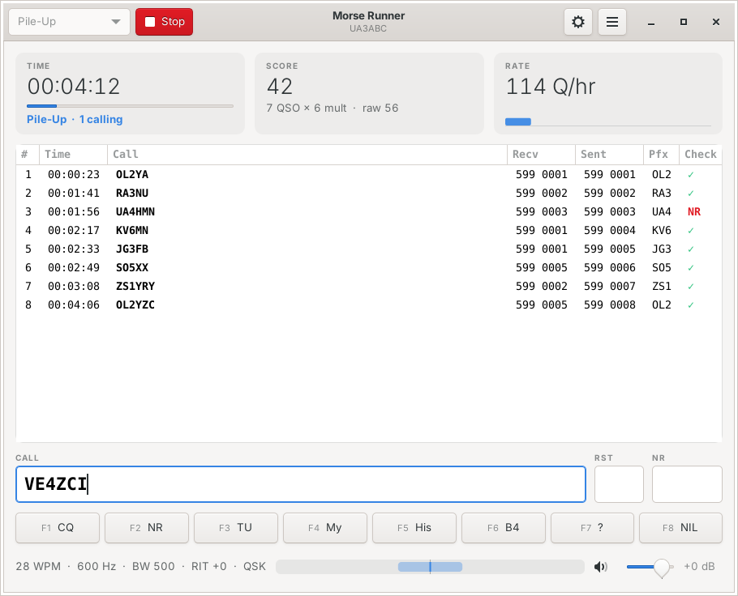
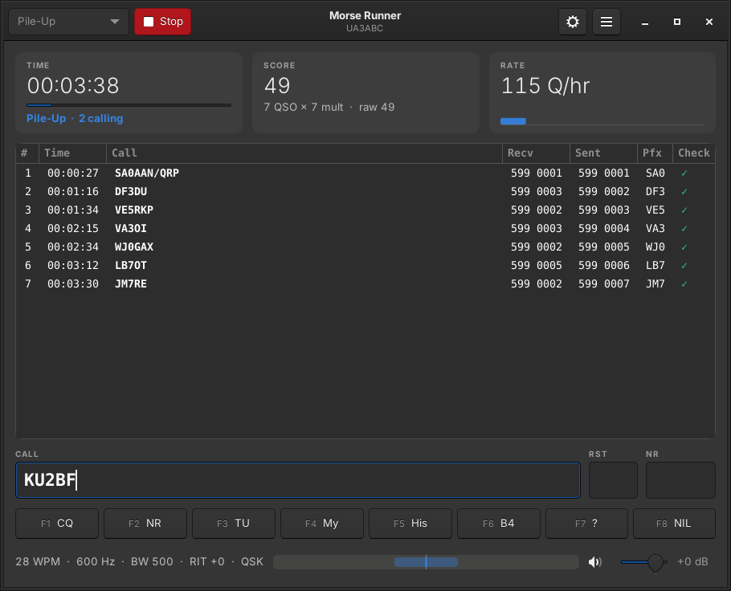
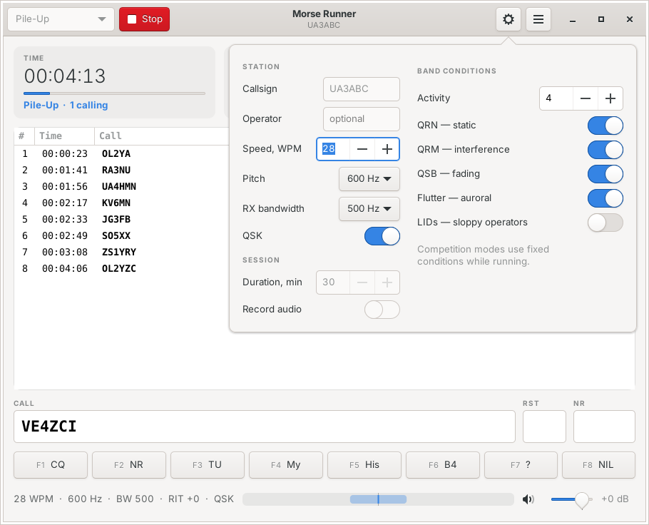

# Morse Runner

A CW contest simulator. Run pile-ups, copy calls through QRM, QRN and fading, and practice
contest operating at your own speed — from the keyboard, without touching the mouse.

Plain C11 with a GTK 3 interface, built with a Makefile; runs on Linux, macOS and Windows.

## Features

- **Realistic band.** Stations with their own speed, pitch, signal strength and operating
  habits call you after a CQ; static crashes (QRN), other stations sending over you (QRM),
  slow fading (QSB), auroral flutter and sloppy operators (LIDs) can be switched on and off.
- **Four modes**: Pile-Up, Single Calls, WPX Competition and HST Competition.
- **Keyboard first.** Enter Sends Message (ESM): one key moves the QSO forward. The F-keys,
  the classic contest shortcuts, RIT and bandwidth on the arrows, speed on PgUp/PgDn. Every
  shortcut can be reassigned; the keys work with any keyboard layout, held keys do not repeat
  a message.
- **Live log checking.** Every QSO is checked against the other station's log: `✓`, or
  `NIL`, `DUP`, `RST`, `NR` for the errors. Verified score, multipliers, QSO rate and a rate
  histogram are updated as you go.
- **Your own call lists.** Add any number of Super Check Partial `.dta` files or plain text
  lists and pick one in the settings — for example, the calls of the championship you are
  preparing for. Without a list, realistic random calls are built from a weighted table of
  active contest prefixes.
- **Receiver controls**: RIT with a passband indicator, 100–600 Hz receive bandwidth,
  300–900 Hz pitch, 10–120 WPM, QSK, self-monitoring level.
- **Score history** of WPX and HST runs, an optional audio recording of the session.
- **Light and dark theme**, either following the desktop or chosen in the menu.

| Dark theme | Settings |
|---|---|
|  |  |

## Build

You need a C11 compiler (gcc or clang), GNU make, pkg-config and GTK 3 (GLib 2.68 or newer).
Audio goes through [miniaudio](https://miniaud.io), bundled in `third_party/`: PulseAudio,
ALSA or JACK on Linux, CoreAudio on macOS, WASAPI or DirectSound on Windows. Without a sound
device the simulation runs silently.

### Linux

Debian, Ubuntu:

    sudo apt install build-essential pkg-config libgtk-3-dev
    make
    ./build/morserunner

Fedora: `sudo dnf install gcc make pkgconf gtk3-devel`, then `make`.

`sudo make install` installs the program, a desktop entry and the icon into `/usr/local`
(`make install PREFIX=/usr` for another prefix, `make uninstall` to remove).
On macOS there is no `make install`: run `build/morserunner`.

### macOS

With [Homebrew](https://brew.sh):

    brew install pkg-config gtk+3
    make
    ./build/morserunner

### Windows

In the UCRT64 shell of [MSYS2](https://www.msys2.org):

    pacman -S make mingw-w64-ucrt-x86_64-{gcc,pkgconf,gtk3}
    make
    ./build/morserunner.exe

To run the program outside the MSYS2 shell, copy the DLLs it needs next to it:

    ldd build/morserunner.exe | grep ucrt64 | awk '{print $3}' | xargs -I{} cp {} build/

Keep the `lang` folder next to `morserunner.exe` for the translations.

### Other targets

| Command | |
|---|---|
| `make test` | build and run the core tests (complete simulated QSOs included); needs GLib only |
| `make lang-check` | check the translations in `lang/` against the texts of the program |
| `make run` | build and start the program |
| `make DEBUG=1` | no optimization, AddressSanitizer and UBSan (Linux, macOS) |
| `make CC=clang` | build with clang |
| `make clean` | remove `build/` |

## Getting started

1. Open the settings (gear button or `Ctrl+,`) and enter your callsign.
2. Choose a mode in the header (`Ctrl+1` … `Ctrl+4`) and press **Enter** (or **F9**).
3. Press **Enter** to call CQ. Type a callsign you hear and press **Enter**: your station
   sends his call and the exchange, and the cursor moves to the NR field.
4. Type his number and press **Enter**: TU is sent and the QSO is logged.

When the other station receives your TU, the log row is checked. A `?` in the call marks a
character you did not copy; when you come back to the field it is selected, so you can type
over it. You can correct a call while it is being sent: the new call goes out if the part
already sent is the same.

### Modes

| Mode | |
|---|---|
| Pile-Up | several stations answer each CQ — copying practice |
| Single Calls | one station calls as soon as the previous QSO is done — speed and typing practice |
| WPX Competition | all band conditions on, fixed duration (60 min), the score is saved to the history |
| HST Competition | IARU High Speed Telegraphy rules: clean band, 600 Hz bandwidth, score by call length |

### Keyboard

The default keys:

| Key | Action |
|---|---|
| Enter | send what the QSO needs next, log it when complete (ESM) |
| Ctrl/Shift/Alt+Enter | log the QSO |
| F1 … F8 | CQ, exchange, TU, my call, his call, QSO B4, ?, NIL (`\` = F1) |
| `;`, Insert | his call + exchange |
| `.`, `+`, `,`, `[`, keypad `.` | TU and log the QSO |
| Esc | stop sending |
| Space | next field, fills in 599 |
| Tab / Shift+Tab | next / previous field |
| Ctrl+W, Alt+W, F11 | clear the fields |
| Up / Down | RIT ±50 Hz |
| Ctrl+Up / Ctrl+Down, Alt+Up / Alt+Down | receiver bandwidth ±50 Hz |
| PgUp / PgDn | speed ±5 WPM |
| Enter, F9 (stopped) | start the mode chosen in the header |
| Ctrl+F9 (stopped) | start the HST competition |
| Ctrl+R | start / stop |
| Ctrl+1 … Ctrl+4 | Pile-Up, Single Calls, WPX, HST |
| Ctrl+, | settings (Esc returns to the QSO) |
| Ctrl+? | all shortcuts, change them |

Every shortcut can be changed: menu → Keyboard Shortcuts (Ctrl+?). Click a key to press a
new one, **+** adds one more key to the action, the arrow button restores the default. A key
taken by another action moves to the new one; letters, digits and the editing keys cannot
be shortcuts, they type the call. The keys are saved in the `[Keys]` section of
`MorseRunner.ini`.

With a non-Latin layout (Russian, for example) the keys still work: the Latin character
of the key is used. If the cursor has left the QSO fields, typing goes to the call field.

On macOS, Ctrl+R, Ctrl+, and Ctrl+? are Cmd+R, Cmd+, and Cmd+?. The F-keys are media keys
there unless you hold Fn (or turn on "Use F1, F2, etc. keys as standard function keys");
everything also works without them: Enter, `;`, `.`, `\`. F11 shows the desktop on a Mac —
use Ctrl+W to clear the fields; Ctrl+Up/Down belong to Mission Control — use Option+Up/Down.

### Call lists

The calling stations take their callsigns from the list chosen in the settings (**Call list**).
A list is a Super Check Partial file (`.dta`, for example `Master.dta` from
[supercheckpartial.com](https://www.supercheckpartial.com)) or a text file with one call
per line (`#` and `;` start a comment).

- **Add…** checks the file, copies it into the calls folder and selects it.
- **Remove** deletes the selected list; the generated calls are used again.
- The folder button opens the calls folder: files put there by hand appear in the list too.
  On Windows, `.dta` files next to `morserunner.exe` are listed as well.

To get used to the calls of a particular contest — say, the Russian HF Championship — add a
list of its participants and run Pile-Up or Single Calls with it. In HST mode a call is not
repeated within a run. The list can only be changed while the contest is stopped.

### Theme

Menu → Theme: **As in the System** follows the desktop (GTK theme, `GTK_THEME`, GNOME dark
style, Windows and macOS dark mode); **Light** and **Dark** work whatever the desktop uses.

### Language

Menu → Language: **As in the System** follows the desktop language, or pick one of the
translations found; the new language is used from the next start. English and Russian come
with the program.

A translation is a plain text file `lang/<code>.ini`. To add a language, copy
[`lang/en.ini`](lang/en.ini) to, say, `de.ini`, set `Name` and `Code`, translate the texts
after the `=` (keep `%s`, `%d` and the other `%` codes in their order) and put the file into
the `lang` folder of the data folder (see below) — it appears in the menu. A text left out
stays in English; deleting the file removes the language. `make lang-check` checks the
translations in `lang/` against the texts of the program.

## Files

| | Linux | macOS | Windows |
|---|---|---|---|
| settings | `~/.config/morserunner` | `~/Library/Application Support/morserunner` | `%LOCALAPPDATA%\morserunner` |
| data | `~/.local/share/morserunner` | `~/Library/Application Support/morserunner` | `%LOCALAPPDATA%\morserunner` |

The settings are in `MorseRunner.ini`. The data folder (menu → Open Data Folder) holds:

| File | |
|---|---|
| `calls/` | your call lists |
| `lang/` | your translations (they take precedence over the installed ones) |
| `ScoreList.txt` | WPX results: date, call, QSO points, multipliers |
| `HstResults.txt` | HST results |
| `MorseRunner.wav` | the recording of the last session (Settings → Record audio) |

The files of earlier versions (folders named `MorseRunner`) are moved here on the first start.

A few options exist only in the INI file:

    [Station]
    CallsFromKeyer=true   ; your keyer sends the calls, the program does not (not in WPX/HST)
    [Contest]
    CompetitionDuration=60
    [System]
    BufSize=3             ; audio block of 64 << BufSize samples, 1..5: smaller = faster response

## Source layout

    src/core/      the simulation: C11 on GLib, no GUI or audio code
      keyer        text -> Morse -> keying envelope with shaped edges
      dsp          receiver filter, modulator, AGC
      station      my station, the callers and their operators, QRM, QRN, QSB
      contest      the band: mixes the stations, noise and my signal into audio blocks
      qsolog       log checking, WPX prefixes and scoring
      calllist     Master.dta and text call lists, callsign generator
      buf, rnd     audio sample buffers, random number distributions
    src/audio/     miniaudio output
    src/ui/        GTK 3 window, settings, theme, keyboard shortcuts, translations
    tests/         core tests
    lang/          translations of the interface
    res/           icon, desktop entry, Windows resources
    tools/         lang-check.sh

## По-русски

Morse Runner — симулятор CW-контеста: pile-up, приём позывных сквозь помехи и замирания,
работа в контесте в своём темпе. Написан на C11 с интерфейсом на GTK 3, собирается `make`
на Linux, macOS и Windows (MSYS2), тесты — `make test`.

Позывной задаётся в настройках (шестерёнка или `Ctrl+,`), режим выбирается в заголовке окна,
старт — клавишей Enter, `Ctrl+F9` сразу запускает HST. Дальше Enter ведёт QSO: CQ → позывной
корреспондента и контрольный номер → TU и запись в лог. Горячие клавиши работают и в русской
раскладке.

Свои списки позывных (`.dta` Super Check Partial или текст, позывной в строке) добавляются в
настройках, блок **Call list**: так можно заранее привыкнуть к позывным конкретного соревнования,
например чемпионата России на КВ.

Интерфейс переведён на русский: меню → Language → Русский (или «как в системе»). Перевод —
обычный текстовый файл `lang/ru.ini`; свой язык добавляется копией `lang/en.ini` в папку `lang`
папки данных.

## License

[Mozilla Public License 2.0](LICENSE). miniaudio is public domain (MIT No Attribution).
